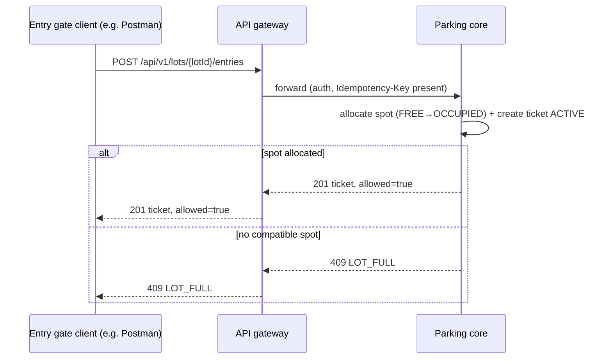
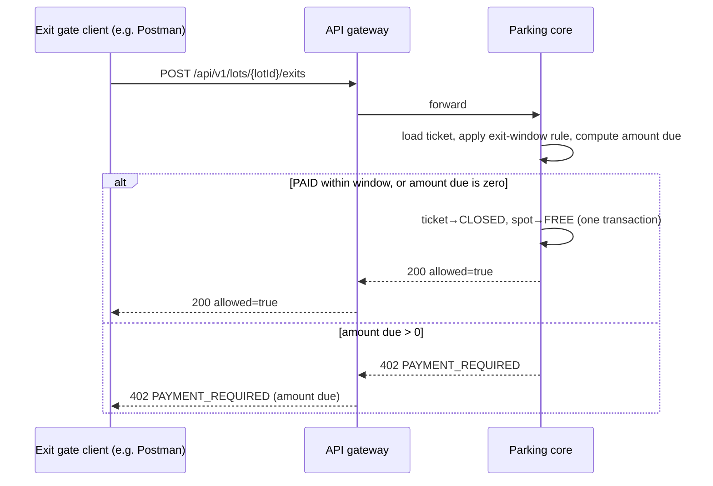
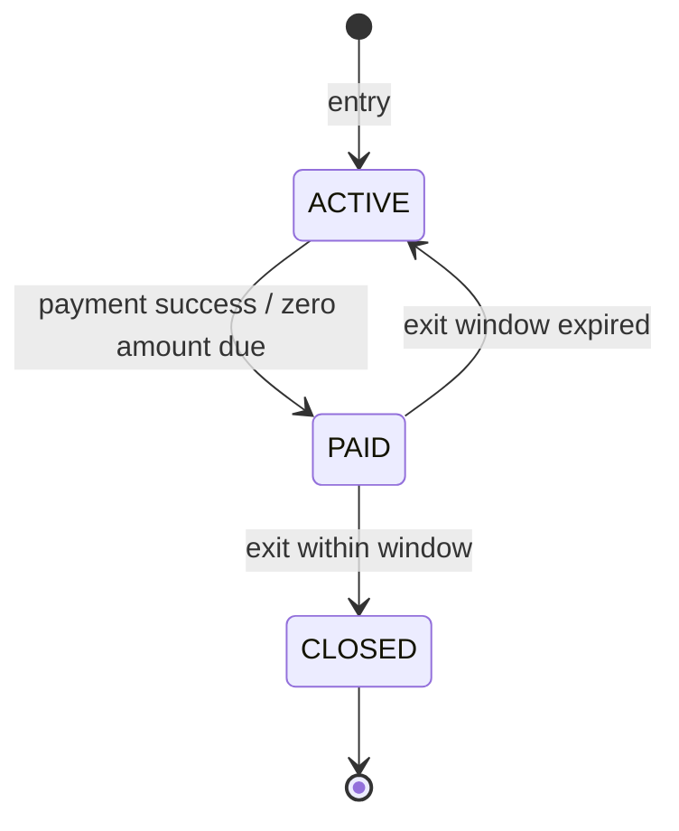

# Spec Delta

## Purpose

Covers a vehicle's stay from entry to exit: issuing a ticket, finding it again at exit, and
the ticket lifecycle that decides whether the caller may open the barrier.

## ADDED Requirements

### Requirement: REQ-TKT-001 Issue ticket on entry
An entry request SHALL carry `gateId`, `licensePlate`, `vehicleType` and optional `accessibleNeeded`. On success the system SHALL create an ACTIVE ticket with `ticketId`, `lotId`, `licensePlate`, `vehicleType`, `spotId`, `entryGateId` and server-assigned `entryTime`, and respond `201` with the ticket, floor number, spot code and `allowed=true`.

#### Scenario: Successful entry
- **WHEN** a CAR with plate KA01AB1234 enters at an ENTRY gate and a compatible spot is free
- **THEN** the system responds `201` with a new ACTIVE ticket, its spot, floor number, entry time and `allowed=true`

### Requirement: REQ-TKT-002 One active ticket per vehicle
A license plate SHALL have at most one ACTIVE or PAID ticket per lot at a time.

#### Scenario: Vehicle already inside
- **WHEN** plate KA01AB1234 enters lot L1 while it already has an ACTIVE ticket in L1
- **THEN** the system responds `409` code `VEHICLE_ALREADY_PARKED` and no spot is allocated

### Requirement: REQ-TKT-003 Exit at an exit gate
An exit request SHALL carry an EXIT `gateId` and either `ticketId` or `licensePlate`. The system SHALL respond `200` with `allowed=true` only when the ticket is PAID within its exit window (REQ-TKT-005) or its amount due is zero; the ticket then becomes CLOSED with `exitTime` and `exitGateId`, and its spot FREE, in one atomic step.

#### Scenario: Paid ticket exits
- **WHEN** a ticket paid 5 minutes ago is presented at an EXIT gate and the exit window is 15 minutes
- **THEN** the system responds `200` with `allowed=true`, the ticket becomes CLOSED with `exitTime` and `exitGateId` set, and the spot becomes FREE

#### Scenario: Unpaid ticket blocked
- **WHEN** an ACTIVE ticket with a non-zero amount due is presented at an EXIT gate
- **THEN** the system responds `402` code `PAYMENT_REQUIRED` with the amount due, and nothing changes

#### Scenario: Zero fee exits without payment
- **WHEN** an ACTIVE ticket exits within the grace period so the amount due is zero
- **THEN** the ticket goes ACTIVE→PAID→CLOSED, no payment record is created, and the response is `200` with `allowed=true`

#### Scenario: Exit at an entry gate rejected
- **WHEN** an exit request names a gate of type ENTRY
- **THEN** the system responds `422` code `WRONG_GATE_TYPE` and nothing changes

### Requirement: REQ-TKT-004 Ticket lookup
The system SHALL return a ticket's state, spot, entry time, amount already paid and current amount due by `ticketId`. A CUSTOMER SHALL also supply the matching `licensePlate`; a missing or mismatching plate SHALL be answered as if the ticket did not exist.

#### Scenario: Get ticket
- **WHEN** an ATTENDANT requests ticket T1 that has been ACTIVE for 90 minutes
- **THEN** the response contains state ACTIVE, the spot, entry time, amount paid 0.00 and the amount due for 90 minutes

#### Scenario: Customer with matching plate
- **WHEN** a CUSTOMER requests ticket T1 with the plate that T1 was issued for
- **THEN** the system returns the ticket

#### Scenario: Customer with wrong plate
- **WHEN** a CUSTOMER requests ticket T1 with a different plate
- **THEN** the system responds `404` code `TICKET_NOT_FOUND`

#### Scenario: Unknown ticket
- **WHEN** a client requests a ticket id that does not exist in the lot
- **THEN** the system responds `404` code `TICKET_NOT_FOUND`

### Requirement: REQ-TKT-005 Exit window after payment
A PAID ticket SHALL be allowed to exit only within `exitWindowMinutes` (from the lot's rate card) after its last successful payment. Once the window has passed, the ticket SHALL return to ACTIVE, and its amount due SHALL be the fee from entry to now minus the amount already paid.

#### Scenario: Overstay after payment
- **WHEN** a ticket paid 80.00 twenty minutes ago is presented at exit, the window is 15 minutes, and the fee from entry to now is 120.00
- **THEN** the ticket becomes ACTIVE and the system responds `402` code `PAYMENT_REQUIRED` with amount due 40.00

#### Scenario: Lookup reports the effective state without changing it
- **WHEN** a client looks up a PAID ticket whose exit window has passed
- **THEN** the response shows state ACTIVE and the remaining amount due, and the stored ticket is only changed by the next quote, payment or exit

#### Scenario: Pay the remainder and exit
- **WHEN** that ticket's remaining 40.00 is paid and it exits within the new window
- **THEN** the system responds `200` with `allowed=true` and the ticket becomes CLOSED

### Requirement: REQ-TKT-006 Ticket state machine
A ticket SHALL have exactly the states ACTIVE, PAID and CLOSED with only these transitions: ACTIVE→PAID, PAID→CLOSED, PAID→ACTIVE (exit window expired). Any other transition SHALL be rejected with `409` code `ILLEGAL_STATE_TRANSITION`.

#### Scenario: Active to paid
- **WHEN** payment for an ACTIVE ticket succeeds
- **THEN** the ticket becomes PAID

#### Scenario: Paid to closed
- **WHEN** a PAID ticket exits within its exit window
- **THEN** the ticket becomes CLOSED

#### Scenario: Paid to active
- **WHEN** a PAID ticket is evaluated after its exit window has passed
- **THEN** the ticket becomes ACTIVE

#### Scenario: Illegal transition
- **WHEN** a client tries to pay a CLOSED ticket
- **THEN** the system responds `409` code `ILLEGAL_STATE_TRANSITION` and the ticket stays CLOSED
