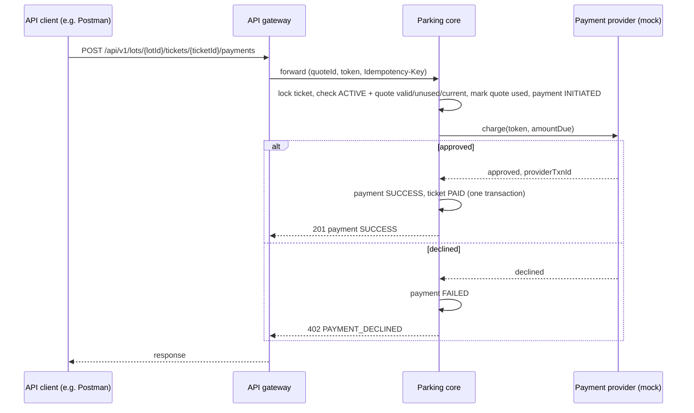
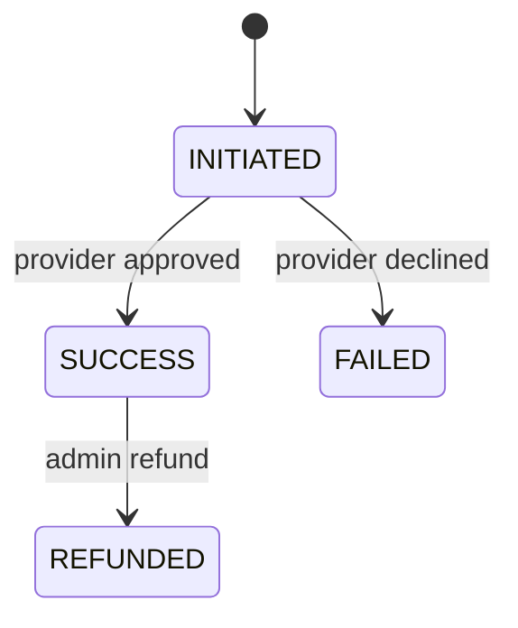

# Spec Delta

## Purpose

Takes payment for a ticket's fee safely: only payment tokens are accepted, retries never charge
twice, and a successful payment is what moves a ticket to PAID.

## ADDED Requirements

### Requirement: REQ-PAY-001 Tokens only, no card data
The payment API SHALL accept only a `quoteId`, a `paymentToken` and a `method` (`CARD`, `UPI`, `WALLET`, `CASH`); requests containing card number, CVV or expiry fields SHALL be rejected, and card data SHALL never be stored or logged.

#### Scenario: Card number rejected
- **WHEN** a payment request body contains a `cardNumber` field
- **THEN** the system responds `400` code `CARD_DATA_NOT_ALLOWED` and nothing is stored

### Requirement: REQ-PAY-002 Pay a ticket
A payment for an ACTIVE ticket SHALL reference an unexpired quote of that ticket (REQ-PRC-005) and charge exactly the quote's `amountDue`; on provider success the payment becomes SUCCESS and the ticket becomes PAID.

#### Scenario: Successful payment
- **WHEN** a CARD token pays a valid quote with amountDue 80.00 on an ACTIVE ticket and the provider approves
- **THEN** the payment is SUCCESS for 80.00 with `providerTxnId` and the ticket is PAID

#### Scenario: Quote of another ticket
- **WHEN** the `quoteId` belongs to a different ticket
- **THEN** the system responds `409` code `QUOTE_MISMATCH` and no charge is made

#### Scenario: Nothing due
- **WHEN** the quote's `amountDue` is 0.00
- **THEN** the system responds `409` code `NOTHING_DUE`, no payment record is created, and the ticket can exit directly (REQ-TKT-003)

#### Scenario: Provider declines
- **WHEN** the provider declines the token
- **THEN** the payment is FAILED, the ticket state is unchanged and the response is `402` code `PAYMENT_DECLINED`

### Requirement: REQ-PAY-003 Idempotent payment
A payment request SHALL require an `Idempotency-Key`; repeating the same key with the same body SHALL return the original result without charging again.

#### Scenario: Retry after timeout
- **WHEN** a client retries a payment with the same Idempotency-Key after a network timeout
- **THEN** the original payment result is returned and the provider is charged only once

### Requirement: REQ-PAY-004 Refund
An admin SHALL be able to refund a SUCCESS payment in full, only when its ticket is CLOSED; the payment becomes REFUNDED and the ticket stays CLOSED. Refunding a payment of a ticket that is not CLOSED SHALL be rejected with `409` code `TICKET_NOT_CLOSED`.

#### Scenario: Refund success
- **WHEN** an admin refunds a SUCCESS payment of a CLOSED ticket
- **THEN** the payment becomes REFUNDED

#### Scenario: Refund before exit rejected
- **WHEN** an admin refunds a SUCCESS payment of a ticket that is still PAID
- **THEN** the system responds `409` code `TICKET_NOT_CLOSED`, the payment stays SUCCESS and the ticket stays PAID

### Requirement: REQ-PAY-005 Payment state machine
A payment SHALL have exactly the states INITIATED, SUCCESS, FAILED and REFUNDED with only these transitions: INITIATED→SUCCESS, INITIATED→FAILED, SUCCESS→REFUNDED. Any other transition SHALL be rejected with `409` code `ILLEGAL_STATE_TRANSITION`.

#### Scenario: Initiated to success
- **WHEN** the provider approves an INITIATED payment
- **THEN** the payment becomes SUCCESS

#### Scenario: Initiated to failed
- **WHEN** the provider declines an INITIATED payment
- **THEN** the payment becomes FAILED

#### Scenario: Success to refunded
- **WHEN** an admin refunds a SUCCESS payment
- **THEN** the payment becomes REFUNDED

#### Scenario: Illegal transition
- **WHEN** an admin tries to refund a FAILED payment
- **THEN** the system responds `409` code `ILLEGAL_STATE_TRANSITION` and the payment stays FAILED

### Requirement: REQ-PAY-006 Single charge per quote
Before any provider charge, the system SHALL verify under a lock that the ticket is ACTIVE, the quote is unused and its `alreadyPaid` still equals the ticket's paid total, then mark the quote used. A ticket SHALL have at most one INITIATED payment at a time.

#### Scenario: Quote paid twice
- **WHEN** a client pays a quote that has already been used by a payment
- **THEN** the system responds `409` code `QUOTE_ALREADY_USED` and the provider is not called

#### Scenario: Concurrent payments for one ticket
- **WHEN** two payments with different quotes for the same ACTIVE ticket arrive at the same time
- **THEN** the provider is charged exactly once; the other request gets `409` (`QUOTE_ALREADY_USED` or `ILLEGAL_STATE_TRANSITION`) and is not charged

#### Scenario: Stale quote after another payment
- **WHEN** a quote was taken before another payment succeeded for the same ticket
- **THEN** paying it returns `409` code `QUOTE_ALREADY_USED` and no charge is made
