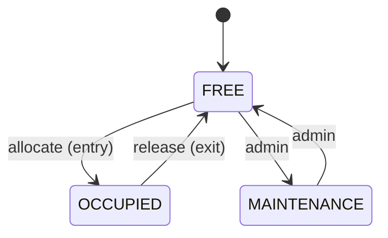

# Spec Delta

## Purpose

Decides which free spot a vehicle gets and guarantees that a spot is never held by two active
tickets, including under concurrent requests from several gates.

## ADDED Requirements

### Requirement: REQ-ALC-001 Nearest compatible spot
On entry the system SHALL allocate a FREE spot of the first compatible spot type (per REQ-LOT-004) that has one, choosing the spot with the lowest `distanceRank`, then lowest `floorNumber`, then `spotCode`.

#### Scenario: Preferred type available
- **WHEN** a CAR enters and COMPACT spots with distanceRank 5 and 2 are free
- **THEN** the COMPACT spot with distanceRank 2 is allocated

#### Scenario: Fallback to larger type
- **WHEN** a CAR enters, no COMPACT spot is free and a REGULAR spot is free
- **THEN** the REGULAR spot is allocated

### Requirement: REQ-ALC-002 No double allocation
A spot SHALL be claimed only if it is FREE at the moment of claiming; two concurrent entries SHALL never receive the same spot.

#### Scenario: Concurrent entries race for last spot
- **WHEN** two entry requests for compatible vehicles arrive concurrently and one compatible spot is free
- **THEN** exactly one request receives the spot and the other is rejected with `409` code `LOT_FULL`

### Requirement: REQ-ALC-003 Lot full rejection
When no compatible FREE spot exists in the lot, the entry SHALL be rejected with `409` and code `LOT_FULL`, and no ticket SHALL be created.

#### Scenario: Lot full
- **WHEN** a VAN enters and every LARGE spot is OCCUPIED or MAINTENANCE
- **THEN** the system responds `409` code `LOT_FULL` and no ticket exists for that vehicle

### Requirement: REQ-ALC-004 Spot state machine
A spot SHALL have exactly the states FREE, OCCUPIED and MAINTENANCE with only these transitions: FREE→OCCUPIED (allocate), OCCUPIED→FREE (release on exit), FREE→MAINTENANCE and MAINTENANCE→FREE (admin). Any other transition SHALL be rejected with `409` code `ILLEGAL_STATE_TRANSITION`.

#### Scenario: Allocate a free spot
- **WHEN** a FREE spot is allocated on entry
- **THEN** its state becomes OCCUPIED

#### Scenario: Release an occupied spot
- **WHEN** the ticket holding an OCCUPIED spot is closed on exit
- **THEN** the spot state becomes FREE

#### Scenario: Put free spot under maintenance
- **WHEN** an admin sets a FREE spot to MAINTENANCE
- **THEN** its state becomes MAINTENANCE and it is never allocated

#### Scenario: Return spot from maintenance
- **WHEN** an admin sets a MAINTENANCE spot to FREE
- **THEN** its state becomes FREE and it can be allocated again

#### Scenario: Illegal transition
- **WHEN** an admin sets an OCCUPIED spot to MAINTENANCE
- **THEN** the system responds `409` code `ILLEGAL_STATE_TRANSITION` and the spot stays OCCUPIED
